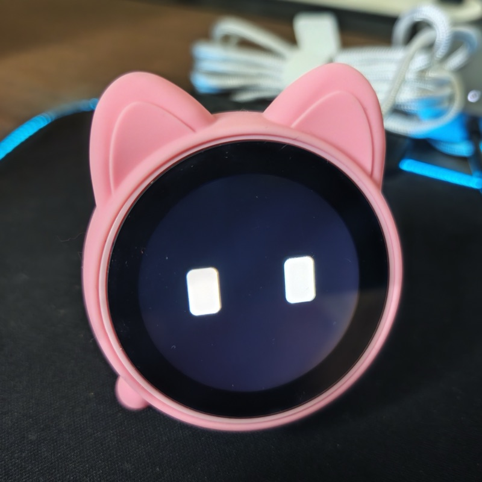
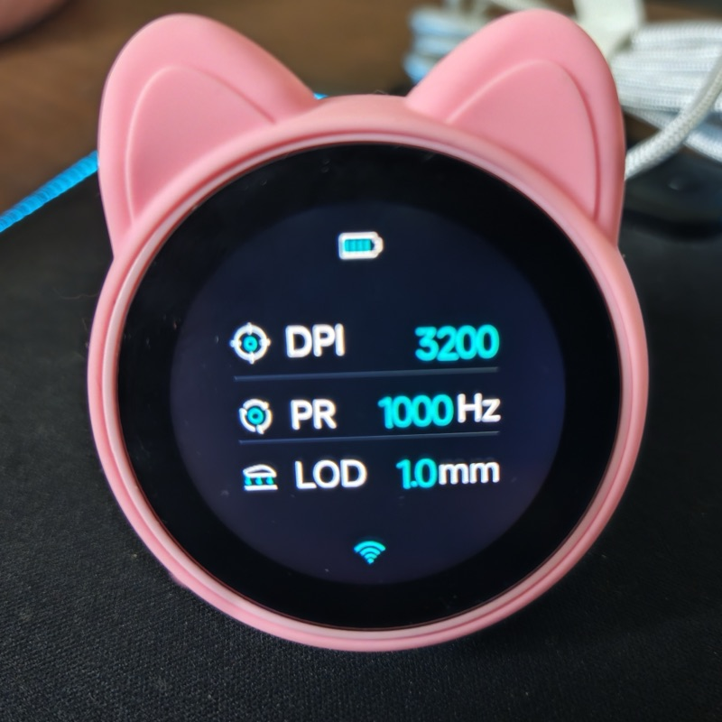
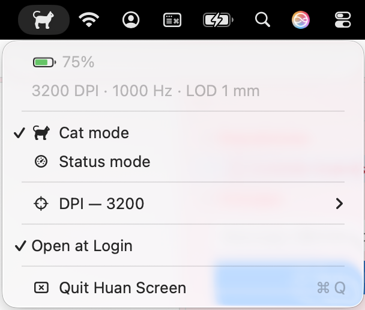

# Huan Screen

macOS menu bar app to switch the **WLMOUSE HUAN 8K receiver** screen between cat and status modes — no driver, no web hub.

<table>
  <tr>
    <td></td>
    <td></td>
  </tr>
  <tr>
    <td align="center"><b>Cat mode</b>: the receiver shows its animated cat (or your custom image)</td>
    <td align="center"><b>Status mode</b>: the receiver shows the mouse stats (DPI, polling rate, LOD)</td>
  </tr>
</table>

The menu also shows the mouse battery level, DPI, polling rate and lift-off distance.

## Requirements

- macOS 13 (Ventura) or later
- A WLMOUSE HUAN 8K receiver plugged in (USB `36A7:A863`)

No special permission is needed: the app talks to the receiver's vendor HID interface, which macOS does not protect behind Input Monitoring.

## Download

1. Download `HuanScreen-<version>.zip` from the [latest release](https://github.com/elythiel/huan-screen/releases/latest).
2. Unzip it and move `Huan Screen.app` to `/Applications`.
3. Open it.

The app is not notarized by Apple, so macOS blocks it on first launch. To allow it, either:

- open **System Settings → Privacy & Security**, scroll down and click **Open Anyway** next to the Huan Screen message;
- or remove the quarantine flag from a terminal:

  ```sh
  xattr -dr com.apple.quarantine "/Applications/Huan Screen.app"
  ```

## Build from source

Requires the Xcode Command Line Tools (`xcode-select --install`).

```sh
git clone git@github.com:elythiel/huan-screen.git
cd huan-screen
make install
```

`make app` only builds `build/Huan Screen.app` (universal binary, ad-hoc signed). `make release` also zips it into `build/HuanScreen-<version>.zip`, the version coming from `Resources/Info.plist`. `make icon` regenerates `Resources/AppIcon.icns` from `scripts/make-icon.swift`. `make install` builds the app, quits the running one, installs it into `/Applications` and launches it. `make uninstall` removes it.

### Releasing

1. `make bump V=0.3.0` sets the version in `Resources/Info.plist`, increments the build number, commits it and creates the annotated tag `v0.3.0` (your editor opens for the tag message).
2. Publish: `git push && git push origin v0.3.0`.

GitHub Actions then builds the app, checks the tag matches the version, and publishes the release with the zip, install notes, SHA-256 and changelog.

## Usage

### Menu bar

Click the icon to open the menu:



The battery turns red below 20% and shows a bolt while charging. A notification warns you when the battery drops to 20%, then 10%; it is re-armed once the mouse charges or goes back above 25%. The menu bar always shows the cat icon, dimmed when the receiver is not plugged in; hover it to see the current mode.

The **DPI** submenu lists the DPI stages of the active profile and switches to the one you pick.

**About Huan Screen** shows the current version and checks GitHub for a newer release at launch, then once a day (you get a notification once per new version). **Update to vX.Y.Z** downloads the release, verifies its SHA-256 against the one published by GitHub, replaces the app and relaunches it. **Check for Updates** checks right away. The only network request the app makes is this check, to `api.github.com`.

Everything is refreshed every 15 seconds, when the receiver is plugged or unplugged, and when the menu opens. A sleeping mouse does not answer: the menu then keeps the last known values.

> When the cat is asleep (screen saver), the receiver only redraws on the next mouse activity. Picking a mode in the menu is mouse activity, so the screen wakes up right after switching.

### Command line

The app binary doubles as a CLI, handy for Raycast, Shortcuts or a keyboard shortcut:

```sh
HUAN="/Applications/Huan Screen.app/Contents/MacOS/HuanScreen"

$HUAN get      # prints "cat" or "status"
$HUAN info     # prints the battery level, DPI, polling rate and lift-off distance
$HUAN cat
$HUAN status
$HUAN toggle
```

It exits with a non-zero status if the receiver is not found.

## Protocol

Found by reading the official WLMOUSE web hub. The receiver exposes a vendor HID interface (usage page `0xFFFF`) with 64-byte feature reports and no report ID.

Each command is a feature report write followed by a feature report read (30 ms later for the receiver, 60 ms for the mouse, which answers over the air). Commands from `80` upwards are reads; the same command without the `80` bit writes.

| Byte | 0 | 1 | 2 | 3 | 4 | 5 | 6… |
| --- | --- | --- | --- | --- | --- | --- | --- |
| Request | `00` | `00` | target | length | group | command | parameters |
| Response | status | `00` | target | length | group | command | values |

- **Target**: `00` receiver, `02` mouse (relayed by the receiver).
- **Status**: `A1` success, `A2` error (for instance when the mouse is asleep).

### Receiver

| Request (bytes 2–6) | Meaning | Response values |
| --- | --- | --- |
| `00 01 05 0A <v>` | Set status display | — (`v`: `00` cat, `01` status) |
| `00 01 05 8A` | Get status display | `00` cat, `01` status |

### Mouse

| Request (bytes 2–7) | Meaning | Response values |
| --- | --- | --- |
| `02 02 00 83` | Battery | charging (`01`), level in % |
| `02 01 00 85` | Active profile | profile (1-based) |
| `02 02 01 82 <profile>` | Active DPI stage | profile, stage (1-based) |
| `02 02 01 02 <profile> <stage>` | Select DPI stage | profile, stage |
| `02 0A 01 81 <profile> 06` | DPI stages | profile, count, then X and Y per stage (16-bit big-endian) |
| `02 02 01 80 <profile>` | Polling rate | profile, code: `08` 125, `04` 250, `02` 500, `01` 1000, `20` 2000, `40` 4000, `80` 8000 Hz |
| `02 03 01 88 <profile>` | Lift-off distance | profile, `01`/`02` mm, `0x80 + tenths`, or BCD (`0x12` = 1.2 mm) |

## Disclaimer

Not affiliated with or endorsed by WLMOUSE. Use at your own risk.

## License

[MIT](LICENSE)
